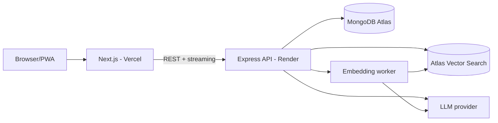

# Architecture: TaskSathi

## 1. Stack

| Layer | Choice |
|---|---|
| Web | Next.js (App Router) + TypeScript, Tailwind, shadcn/ui, Framer Motion, TanStack Query, dnd-kit, streaming UI |
| API | Express **5** + TypeScript, Mongoose, Zod, Pino + pino-http, helmet, express-rate-limit |
| Auth | Access JWT (15 min, `jose`) + rotating refresh token (httpOnly cookie, stored hashed), RBAC |
| DB | MongoDB Atlas M0 + Atlas Vector Search |
| AI | Provider-agnostic `llm/` module. Gemini Flash Lite default, Gemini Embedding 2 for embeddings |
| Jobs | In-process queue for embeddings (Redis only if needed later) |
| Quality | Vitest + Supertest + mongodb-memory-server, eval suite, GitHub Actions |
| Deploy | Vercel (web) + Render (API). Docker for the API later |

Why Express separate from Next.js: long jobs, streaming, and a future mobile client.

## 2. Repo layout (pnpm monorepo)
```
tasksathi/
  apps/
    api/        # Express (Lane A)
      src/
        config/env.ts        # Zod-validated env
        errors/              # AppError, central handler
        routes/ | modules/   # feature-based (auth, workspaces, tasks, ai)
        middleware/          # requireAuth, rbac, rate limits
        db/                  # connect, models
        llm/                 # provider interface, limiter, cache, prompts
        app.ts               # builds the Express app (no listen)
        server.ts            # reads env, listens, graceful shutdown
    web/        # Next.js (Lane B)
  packages/
    shared/     # Zod schemas + types shared by api and web
      src/auth.ts, errors.ts, index.ts
  evals/        # cases.jsonl, run.ts, results/ (Week 4)
  docs/         # these files
```

`@tasksathi/shared` exports **raw `.ts`** (`exports: "./src/index.ts"`). Consequences:
- API dev uses `tsx` (no build step).
- Web needs `transpilePackages: ["@tasksathi/shared"]` in `next.config.ts`.
- API production build uses **`tsup`** with `noExternal: ["@tasksathi/shared"]`. `tsc` cannot be used because shared lives outside the API `rootDir`.

## 3. System flow


## 4. API contract (C0, source of truth for both lanes)

| Endpoint | Request | Success | Failure |
|---|---|---|---|
| `GET /health` | none | 200 `{status:"ok", uptime, version}`; `version` comes from `APP_VERSION` (default `"0.0.0"`); **exempt from rate limiting** | n/a |
| `POST /auth/register` | `{name, email, password>=8}` | 201 `{accessToken, user:{id,name,email}}` + refresh cookie | 400 validation, 409 email exists, 429 rate limited |
| `POST /auth/login` | `{email, password}` | 200 same body + cookie | 401 invalid credentials |
| `POST /auth/refresh` | cookie only | 200 `{accessToken, user}`, cookie rotated | 401 invalid, or reused outside the 10 s grace window (see section 5; reuse inside it is not an error) |
| `POST /auth/logout` | cookie | 204, cookie cleared | n/a |
| `GET /auth/me` | `Authorization: Bearer` | 200 `{user}` | 401 |

**Error shape (always):** `{ error: { code, message, details? } }`, where `details` is `Array<{ path: string, message: string }>` (from Zod) or omitted.
**User shape (always):** `{ id, name, email }`. The API serializes Mongoose `_id` to `id` via a `toJSON` transform and never exposes `passwordHash` or `refreshTokens`. Clients do no ID mapping.
**Codes:** `VALIDATION_ERROR` 400, `UNAUTHORIZED` 401, `FORBIDDEN` 403, `NOT_FOUND` 404, `CONFLICT` 409, `RATE_LIMITED` 429, `INTERNAL` 500.

Later endpoints: workspaces CRUD + members/roles; tasks CRUD with filters, sorting, cursor pagination; `POST /ai/parse-task`, `/ai/subtasks`, `/ai/ask` (streaming), `/ai/agent/propose`, `/ai/agent/approve`; AI usage/cost summary.

**Contract changes require agreement from the user and the primary AI. No lane changes it unilaterally.**

## 5. Auth design
- Access token: 15 min, held **in memory** on the client, never localStorage.
- Refresh token: random 256-bit value, stored as a sha256 hash with a **family id**. Rotated on every refresh. The record also keeps `previousTokenHash` and `previousUsedAt`.
- **Grace window (10 s):** the server cannot return an old token (only hashes are stored). If the presented token is the previous token and was rotated less than 10 s ago, it is not an error: rotate again inside the same family and set a fresh cookie (this covers two tabs refreshing at once or a flaky-network retry). If it was rotated more than 10 s ago, or is unknown, treat it as reuse: revoke the whole family and return 401.
- Cookie `refreshToken`: httpOnly, path `/auth`. Dev: `sameSite=lax`. Prod: `sameSite=none` + `secure` (Vercel and Render are different domains). CORS needs `credentials: true` and an origin allowlist.
- Password hashing: `argon2` (needs `allowBuilds` in `pnpm-workspace.yaml`); fall back to `bcryptjs` if the Windows install fails. Verification dispatches on the hash prefix (`$argon2id$` vs `$2a$` / `$2b$`) so a later migration is possible.
- Client requests use `credentials: "include"`. **Single-flight refresh (client):**
  - **Trigger:** a 401 with `code: "UNAUTHORIZED"` on a protected endpoint.
  - **Behavior:** if no refresh is in flight, start one; if one is in flight, attach to the same promise (never start a second).
  - **Loop guard:** a 401 from `/auth/refresh`, `/auth/login` or `/auth/register` never triggers a refresh.
  - **On success:** replay each queued request once with the new access token. A second 401 on replay redirects to `/login` (no retry loop).
  - **On failure (401, 403, or network):** clear the in-memory token, drop the queue, redirect to `/login`.
  - **Scope:** per tab. Cross-tab is out of scope because the server grace window covers it.
  - **Storage:** memory only. No `localStorage`, no `BroadcastChannel`.
- CORS: origin allowlist from env, `credentials: true`, allowed headers `Content-Type, Authorization`. The `cors` middleware answers `OPTIONS` preflight automatically.
- Dev cookie note: `localhost:3000` and `localhost:4000` are **same-site**, so a `sameSite=lax` cookie is sent with `credentials: include`. Prod crosses domains, so it needs `sameSite=none; secure`.

## 6. Data model

| Collection | Key fields |
|---|---|
| User | name, email (unique), passwordHash, refreshTokens[] (tokenHash, familyId, expiresAt, previousTokenHash, previousUsedAt) |
| Workspace | name, ownerId |
| WorkspaceMember | workspaceId, userId, role |
| Task | workspaceId, title, description, status, priority, dueDate, labels[], assigneeId, parentId, createdBy, embedding, timestamps |
| Comment | taskId, workspaceId, authorId, body |
| AiLog | userId, workspaceId, feature, model, tokensIn, tokensOut, latencyMs, estCost, success, cacheHit |

Indexes: `{workspaceId, status}`, `{workspaceId, dueDate}`, vector index on `Task.embedding` filtered by `workspaceId`. Always scope queries by workspace and user. Avoid embedded unbounded arrays (the v1 mistake).

## 7. AI design

| Feature | Mechanism |
|---|---|
| Quick-add | LLM returns JSON, validated with Zod, one retry, confirm chip before save |
| Subtasks | Same pattern, array output |
| Ask Sathi (RAG) | Chunk and embed on write (background), vector search filtered by workspace, cited answer, validate every cited ID |
| Agent | Model proposes tool calls, UI shows a diff, write only after approval |
| Observability | Every call writes an `AiLog` row |

RAG flow: embed question, vector search (workspace filter, top-k), prompt with question + context + citation rules, validate cited IDs, log tokens and cost, stream the answer with sources.

### Free-tier limits (Google AI Studio console, 2026-11-13; may change)

| Model class | RPM | RPD | Use |
|---|---|---|---|
| Flash Lite | 15 | 500 | Default for all features |
| Other Flash | 5 | 20 | Rare quality spot-checks |
| Embedding 2 | 100 | 1,000 | RAG embeddings |
| Gemma 4 | 30 | 14,400 | Bulk evals (TPM 16K, keep prompts short) |
| Pro | 0 | 0 | Unavailable |

Daily reset at midnight Pacific (~1:45 PM Nepal). **Never hardcode model IDs; read them from env.**

Design consequences: token-bucket limiter + backoff in `llm/`, response cache keyed by (prompt hash, model), per-user AI quota, seeded demo workspace, cached-sample fallback when quota is out, optional bring-your-own key, embed on write via a queue.

To verify, not assume: current Gemini model IDs, the "Gemini Decision 1" console entry, and whether Gemma matches Flash Lite on structured JSON.

### Prompt-injection stance
Task and comment text is untrusted. Use delimiters, retrieved text never triggers actions, writes need approval, outputs are Zod-validated, citations are enforced.

## 8. Eval suite (Week 4)
`evals/cases.jsonl` (~50 cases), `run.ts` (cached runs, results table), `results/` (committed for the README).

| Metric | Measures |
|---|---|
| JSON validity | % outputs passing the Zod schema |
| Field accuracy | Title, date, priority extraction |
| Retrieval hit@k | Right task in top-k |
| Groundedness | Every cited ID exists and supports the answer |
| Cost/latency | Per-feature averages |

CI fails under thresholds. README shows a provider comparison (Gemini Flash Lite vs Gemma vs Claude).

## 9. Deployment notes
- API (Render): build `pnpm install --prod=false && pnpm --filter @tasksathi/api build`; start `node dist/index.js`. `app.set("trust proxy", 1)` is required so rate limiting works behind Render.
- Web (Vercel): `NEXT_PUBLIC_API_URL` env var; correct `vercel.json` spelling.
- Cookies across the two domains need `sameSite=none; secure` plus CORS credentials.
